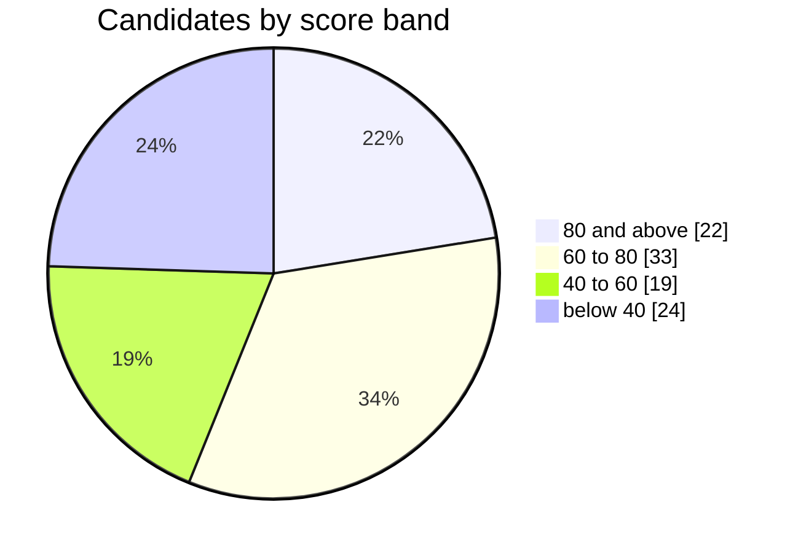

<!-- Generated by `scoresheet render` from data/scorecard.json. Do not edit by hand. -->

# Gno validator scoreboard

Data as of **2026-09-10** · **98** candidates · median score **68.22**

**Score** = (challenge + test13 + topaz + sapphire + pearl + fire drill) / 6 + GitHub / 10, capped at 100.

All six arenas carry equal weight and are final: the testnets have ended and the fire drill has closed. A candidate absent from an arena scores 0 there. The GitHub bonus counts contributions from 2025 on and is worth at most 10 points. Mainnet (`gnoland-1`) is not scored yet.

## Arenas

| Arena | Source | Candidates scored | Median |
| --- | --- | ---: | ---: |
| Challenge | test13 onboarding rubric, rated by hand | 98 | 65.4 |
| test13 | gnomonitoring, frozen CSV of 2026-07-21 | 88 | 80 |
| topaz | gnomonitoring `topaz-1`, frozen CSV of 2026-08-10 | 82 | 84.5 |
| sapphire | gnomonitoring `sapphire-1`, final report | 79 | 84 |
| pearl | gnomonitoring `pearl-1`, final report | 74 | 98 |
| Fire drill | 2026-09-02 exercise, portal exports | 59 | 71 |

## Distribution

| Band | Score | Candidates |
| --- | --- | ---: |
| 🟢 | 80 and above | 22 |
| 🟡 | 60 to 80 | 33 |
| 🟠 | 40 to 60 | 19 |
| 🔴 | below 40 | 24 |

## Ranking

`—` marks a candidate absent from that arena, which counts as 0. Equal scores share a rank.

| # | Validator | Score | | Challenge | test13 | topaz | sapphire | pearl | Fire drill | GitHub |
| ---: | --- | ---: | --- | ---: | ---: | ---: | ---: | ---: | ---: | ---: |
| 1 | 🟢 [Cogwheel](validators/cogwheel.md) | **95.50** | `██████████` | 100 | 85 | 96 | 96 | 100 | 96 | 0 |
| 2 | 🟢 [ITRocket](validators/itrocket.md) | **92.87** | `█████████░` | 85.6 | 85 | 82 | 97 | 100 | 89 | 31 |
| 3 | 🟢 [MictoNode](validators/mictonode.md) | **92.63** | `█████████░` | 88 | 84 | 93 | 97 | 100 | 89 | 8 |
| 4 | 🟢 [Cumulo](validators/cumulo.md) | **92.00** | `█████████░` | 86 | 84 | 93 | 97 | 100 | 89 | 5 |
| 5 | 🟢 [StakeUp](validators/stakeup.md) | **90.33** | `█████████░` | 79 | 84 | 93 | 97 | 100 | 89 | 0 |
| 6 | 🟢 [Perfect-nodes](validators/perfect-nodes.md) | **88.90** | `█████████░` | 70.4 | 84 | 93 | 97 | 100 | 89 | 0 |
| 7 | 🟢 [Conqueror](validators/conqueror.md) | **88.83** | `█████████░` | 88 | 69 | 93 | 96 | 98 | 89 | 0 |
| 8 | 🟢 [UTSA](validators/utsa.md) | **88.40** | `█████████░` | 83.4 | 84 | 93 | 96 | 97 | 77 | 0 |
| 9 | 🟢 [PRO Delegators](validators/pro-delegators.md) | **87.73** | `█████████░` | 78.4 | 78 | 93 | 83 | 100 | 94 | 0 |
| 10 | 🟢 [BlockNth](validators/blocknth.md) | **87.33** | `█████████░` | 97 | 85 | 93 | 97 | 100 | 52 | 0 |
| 11 | 🟢 [Grand Valley](validators/grand-valley.md) | **87.17** | `█████████░` | 60 | 84 | 93 | 97 | 100 | 89 | 0 |
| 12 | 🟢 [pi69](validators/pi69.md) | **84.83** | `████████░░` | 93 | 71 | 78 | 96 | 100 | 71 | 0 |
| 13 | 🟢 [AviaOne](validators/aviaone.md) | **83.63** | `████████░░` | 52 | 85 | 82 | 96 | 90 | 77 | 33 |
| 14 | 🟢 [zardozmonopoly](validators/zardozmonopoly.md) | **83.60** | `████████░░` | 65.4 | 84 | 93 | 54 | 100 | 83 | 37 |
| 15 | 🟢 [ZeycaNode](validators/zeycanode.md) | **83.43** | `████████░░` | 74 | 85 | 73 | 97 | 85 | 77 | 16 |
| 16 | 🟢 [VinjanInc](validators/vinjaninc.md) | **82.90** | `████████░░` | 73.4 | 84 | 93 | 97 | 98 | 52 | 0 |
| 17 | 🟢 [Chainbase](validators/chainbase.md) | **82.50** | `████████░░` | 97 | 69 | 84 | 95 | 98 | 52 | 0 |
| 18 | 🟢 [OshVanK](validators/oshvank.md) | **82.27** | `████████░░` | 71.6 | 85 | 63 | 95 | 83 | 96 | 0 |
| 19 | 🟢 [KaLaMuC](validators/kalamuc.md) | **81.00** | `████████░░` | 53 | 84 | 93 | 97 | 100 | 59 | 0 |
| 19 | 🟢 [GATA HUB](validators/gata-hub.md) | **81.00** | `████████░░` | 81 | 84 | 98 | 60 | 92 | 71 | 0 |
| 21 | 🟢 [Chicharito](validators/chicharito.md) | **80.40** | `████████░░` | 73.4 | 67 | 93 | 93 | 96 | 60 | 0 |
| 22 | 🟢 [Apollo](validators/apollo.md) | **80.33** | `████████░░` | 77 | 84 | 45 | 87 | 100 | 89 | 0 |
| 23 | 🟡 [linkednode](validators/linkednode.md) | **79.83** | `████████░░` | 75 | 82 | 71 | 94 | 98 | 59 | 0 |
| 24 | 🟡 [nomadvalidator](validators/nomadvalidator.md) | **79.27** | `████████░░` | 69.6 | 66 | 77 | 82 | 98 | 83 | 0 |
| 25 | 🟡 [dnsarz](validators/dnsarz.md) | **78.57** | `████████░░` | 63.4 | 84 | 93 | 73 | 100 | 58 | 0 |
| 26 | 🟡 [offellNode](validators/offellnode.md) | **78.40** | `████████░░` | 58.4 | 82 | 58 | 97 | 98 | 77 | 0 |
| 27 | 🟡 [ESERCKR](validators/eserckr.md) | **78.07** | `████████░░` | 68.4 | 67 | 85 | 96 | 100 | 52 | 0 |
| 28 | 🟡 [CoreNode](validators/corenode.md) | **76.83** | `████████░░` | 35 | 84 | 92 | 96 | 98 | 56 | 0 |
| 29 | 🟡 [NODESYNC](validators/nodesync.md) | **75.83** | `████████░░` | 83 | 68 | 76 | 70 | 100 | 58 | 0 |
| 29 | 🟡 [POSTHUMAN](validators/posthuman.md) | **75.83** | `████████░░` | 74 | 84 | 33 | 96 | 98 | 70 | 0 |
| 31 | 🟡 [Chiter in Cosmos](validators/chiter-in-cosmos.md) | **75.67** | `████████░░` | 80 | 84 | 56 | 96 | 86 | 52 | 0 |
| 32 | 🟡 [cunum](validators/cunum.md) | **75.57** | `████████░░` | 31.4 | 76 | 93 | 97 | 100 | 56 | 0 |
| 33 | 🟡 [Kromo127](validators/kromo127.md) | **75.33** | `████████░░` | 73 | 59 | 93 | 77 | 98 | 52 | 0 |
| 33 | 🟡 [Sychonix](validators/sychonix.md) | **75.33** | `████████░░` | 59 | 69 | 77 | 95 | 100 | 52 | 0 |
| 35 | 🟡 [Kleomedes](validators/kleomedes.md) | **73.60** | `███████░░░` | 85.6 | 70 | 57 | 60 | 98 | 71 | 0 |
| 36 | 🟡 [HazenNetworkSolutions](validators/hazennetworksolutions.md) | **73.43** | `███████░░░` | 61 | 84 | 95 | 97 | 100 | — | 6 |
| 37 | 🟡 [Vicky\_Pulsican](validators/vicky-pulsican.md) | **73.40** | `███████░░░` | 75.4 | 80 | 68 | 44 | 98 | 75 | 0 |
| 38 | 🟡 [kgnodes](validators/kgnodes.md) | **73.33** | `███████░░░` | 68 | 84 | 92 | 96 | 100 | — | 0 |
| 39 | 🟡 [coinsspor](validators/coinsspor.md) | **72.47** | `███████░░░` | 85 | 67 | 92 | 80 | 100 | — | 18 |
| 40 | 🟡 [TeoViTeoVi](validators/teoviteovi.md) | **71.83** | `███████░░░` | 37 | 80 | 82 | 84 | 83 | 65 | 0 |
| 41 | 🟡 [HusoNode](validators/husonode.md) | **71.50** | `███████░░░` | 58 | 63 | 71 | 61 | 87 | 89 | 0 |
| 42 | 🟡 [n1stake](validators/n1stake.md) | **71.33** | `███████░░░` | 74 | 67 | 96 | 10 | 98 | 77 | 10 |
| 43 | 🟡 [2NH](validators/2nh.md) | **70.83** | `███████░░░` | 72 | 78 | 65 | 54 | 79 | 77 | 0 |
| 44 | 🟡 [ChainTools](validators/chaintools.md) | **70.77** | `███████░░░` | 56.6 | 82 | 89 | 97 | 100 | — | 0 |
| 45 | 🟡 [Inter Blockchain Services](validators/inter-blockchain-services.md) | **69.83** | `███████░░░` | 0 | 73 | 91 | 78 | 100 | 77 | 0 |
| 46 | 🟡 [ruangnode](validators/ruangnode.md) | **69.67** | `███████░░░` | 86 | 80 | 19 | 74 | 100 | 59 | 0 |
| 47 | 🟡 [Nodeist](validators/nodeist.md) | **69.17** | `███████░░░` | 68 | 69 | 72 | 77 | 77 | 52 | 0 |
| 48 | 🟡 [testovich](validators/testovich.md) | **68.77** | `███████░░░` | 67.6 | 84 | 93 | — | 97 | 71 | 0 |
| 49 | 🟡 [KonsorTech](validators/konsortech.md) | **68.67** | `███████░░░` | 53 | 70 | 94 | 98 | 97 | — | 0 |
| 50 | 🟡 [nsk1984](validators/nsk1984.md) | **67.77** | `███████░░░` | 46.6 | 83 | 96 | 83 | 98 | — | 0 |
| 51 | 🟡 [doresa](validators/doresa.md) | **67.23** | `███████░░░` | 45.4 | 71 | 35 | 100 | 100 | 52 | 0 |
| 52 | 🟡 [BZE Community](validators/bze-community.md) | **66.93** | `███████░░░` | 28.6 | 84 | 93 | 96 | 100 | — | 0 |
| 53 | 🟡 [Fluxen](validators/fluxen.md) | **64.83** | `██████░░░░` | 56 | 0 | 84 | 97 | 100 | 52 | 0 |
| 54 | 🟡 [Umair\_ChainGuard](validators/umair-chainguard.md) | **62.67** | `██████░░░░` | 73 | 73 | 74 | 0 | 98 | 58 | 0 |
| 55 | 🟡 [NakoTurk](validators/nakoturk.md) | **62.17** | `██████░░░░` | 59 | 47 | 91 | 93 | 83 | — | 0 |
| 56 | 🟠 [NyanCat](validators/nyancat.md) | **59.67** | `██████░░░░` | 44 | 0 | 91 | 94 | 40 | 89 | 0 |
| 57 | 🟠 [Sr20de](validators/sr20de.md) | **59.50** | `██████░░░░` | 38 | 69 | 62 | 96 | 92 | — | 0 |
| 58 | 🟠 [OnNode](validators/onnode.md) | **57.50** | `██████░░░░` | 68 | 84 | 93 | 48 | 52 | — | 0 |
| 59 | 🟠 [CrypTech](validators/cryptech.md) | **57.33** | `██████░░░░` | 68 | 0 | 82 | 11 | 94 | 89 | 0 |
| 60 | 🟠 [BoyGau](validators/boygau.md) | **56.90** | `██████░░░░` | 53.4 | 82 | 61 | 7 | 79 | 59 | 0 |
| 61 | 🟠 [1XP](validators/1xp.md) | **55.73** | `██████░░░░` | 55.4 | 82 | 38 | 61 | 98 | — | 0 |
| 61 | 🟠 [LuckyStar](validators/luckystar.md) | **55.73** | `██████░░░░` | 78.4 | 38 | 45 | 30 | 54 | 89 | 0 |
| 63 | 🟠 [TheGoodEscobar](validators/thegoodescobar.md) | **54.60** | `█████░░░░░` | 57.6 | 0 | 94 | 26 | 98 | 52 | 0 |
| 64 | 🟠 [MIPEnode](validators/mipenode.md) | **54.33** | `█████░░░░░` | 57 | 43 | 58 | 5 | 98 | 65 | 0 |
| 65 | 🟠 [KalpaTech](validators/kalpatech.md) | **54.10** | `█████░░░░░` | 59.6 | 0 | 70 | 52 | 73 | 70 | 0 |
| 66 | 🟠 [tanjira](validators/tanjira.md) | **53.83** | `█████░░░░░` | 70 | 38 | 38 | 6 | 100 | 71 | 0 |
| 67 | 🟠 [NodeSafe](validators/nodesafe.md) | **53.10** | `█████░░░░░` | 37.6 | 61 | 93 | 32 | 6 | 89 | 0 |
| 68 | 🟠 [Provalidator](validators/provalidator.md) | **49.93** | `█████░░░░░` | 44.6 | 84 | 76 | 95 | 0 | — | 0 |
| 69 | 🟠 [Santala-Research](validators/santala-research.md) | **48.73** | `█████░░░░░` | 62.4 | 14 | 11 | 24 | 98 | 83 | 0 |
| 70 | 🟠 [plantree](validators/plantree.md) | **45.00** | `█████░░░░░` | 60 | 82 | 92 | 36 | — | — | 0 |
| 71 | 🟠 [Oneiric Stake](validators/oneiric-stake.md) | **41.17** | `████░░░░░░` | 43 | 57 | 58 | 11 | 6 | 69 | 5 |
| 72 | 🟠 [Shazoes](validators/shazoes.md) | **41.10** | `████░░░░░░` | 47.6 | 84 | 55 | 60 | — | — | 0 |
| 73 | 🟠 [EmberStake](validators/emberstake.md) | **40.77** | `████░░░░░░` | 67.6 | 84 | 93 | — | — | — | 0 |
| 74 | 🟠 [EquinoxDao](validators/equinoxdao.md) | **40.73** | `████░░░░░░` | 70.4 | 84 | 90 | 0 | — | — | 0 |
| 75 | 🔴 [Huginn](validators/huginn.md) | **38.67** | `████░░░░░░` | 80 | 61 | 91 | — | — | — | 0 |
| 76 | 🔴 [Trace](validators/trace.md) | **36.10** | `████░░░░░░` | 39.6 | 84 | — | 93 | — | — | 0 |
| 77 | 🔴 [OwlStake](validators/owlstake.md) | **34.90** | `███░░░░░░░` | 52.4 | 30 | 19 | 46 | 62 | — | 0 |
| 78 | 🔴 [validatorsg](validators/validatorsg.md) | **31.50** | `███░░░░░░░` | 54 | 17 | 34 | 0 | 32 | 52 | 0 |
| 79 | 🔴 [Nodeshub](validators/nodeshub.md) | **30.67** | `███░░░░░░░` | 76 | 0 | 91 | 17 | — | — | 0 |
| 80 | 🔴 [Ubik Capital](validators/ubik-capital.md) | **26.50** | `███░░░░░░░` | 69 | 84 | — | — | — | — | 10 |
| 81 | 🔴 [Tecnodes](validators/tecnodes.md) | **23.57** | `██░░░░░░░░` | 45.4 | 0 | 96 | 0 | — | — | 0 |
| 82 | 🔴 [Stella](validators/stella.md) | **22.83** | `██░░░░░░░░` | 55 | 82 | — | — | — | — | 0 |
| 83 | 🔴 [Node39](validators/node39.md) | **22.60** | `██░░░░░░░░` | 66.6 | 69 | — | — | — | — | 0 |
| 84 | 🔴 [PrimeStake](validators/primestake.md) | **21.17** | `██░░░░░░░░` | 45 | 82 | — | — | — | — | 0 |
| 85 | 🔴 [Nodedog](validators/nodedog.md) | **20.00** | `██░░░░░░░░` | 38 | 82 | — | — | — | — | 0 |
| 86 | 🔴 [VALIDARIOS](validators/validarios.md) | **17.77** | `██░░░░░░░░` | 54.6 | 20 | 0 | 7 | 25 | — | 0 |
| 87 | 🔴 [Roomit](validators/roomit.md) | **14.73** | `█░░░░░░░░░` | 88.4 | 0 | 0 | — | — | — | 0 |
| 88 | 🔴 [HaruNode](validators/harunode.md) | **13.57** | `█░░░░░░░░░` | 65.4 | 0 | 0 | 0 | 16 | — | 0 |
| 89 | 🔴 [Validatus](validators/validatus.md) | **12.83** | `█░░░░░░░░░` | 77 | — | — | — | — | — | 0 |
| 90 | 🔴 [AstroStake](validators/astrostake.md) | **12.07** | `█░░░░░░░░░` | 72.4 | — | — | — | — | — | 0 |
| 91 | 🔴 [johnwiard](validators/johnwiard.md) | **9.50** | `█░░░░░░░░░` | 57 | — | — | — | — | — | 0 |
| 92 | 🔴 [BonyNode](validators/bonynode.md) | **8.00** | `█░░░░░░░░░` | 48 | — | — | — | — | — | 0 |
| 93 | 🔴 [web34ever](validators/web34ever.md) | **7.43** | `█░░░░░░░░░` | 44.6 | — | — | — | — | — | 0 |
| 94 | 🔴 [NODERS](validators/noders.md) | **6.50** | `█░░░░░░░░░` | 39 | — | — | — | — | — | 0 |
| 95 | 🔴 [kazzimkoc](validators/kazzimkoc.md) | **5.33** | `█░░░░░░░░░` | 32 | — | — | — | — | — | 0 |
| 96 | 🔴 [CentNode](validators/centnode.md) | **3.17** | `░░░░░░░░░░` | 19 | — | — | — | — | — | 0 |
| 97 | 🔴 [0xyzBlock](validators/0xyzblock.md) | **0.00** | `░░░░░░░░░░` | 0 | — | — | — | — | — | 0 |
| 97 | 🔴 [dongqn](validators/dongqn.md) | **0.00** | `░░░░░░░░░░` | 0 | — | — | — | — | — | 0 |
